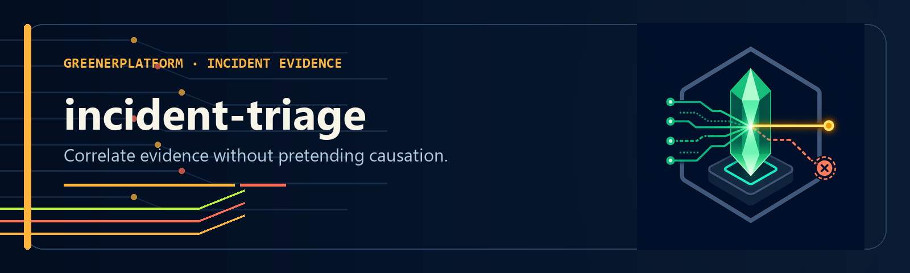

<div align="center">
  
</div>

<div align="center">
  
  
  
  
  
  
</div>

<p align="center"><em>A rule-based correlation layer for incident triage: alert plus snapshot in, ranked evidence and an auditable hypothesis out.</em></p>

---

## What it does

incident-triage ranks findings from a kubectl-sentinel report against a normalized alert.
It emits candidate causes, parallel findings, evidence gaps, event timing, confidence, and
response steps for operator review.

> **Alert in. Ranked evidence and an incident hypothesis out.**

```bash
python3 incident_triage.py \
  --sentinel-json tests/fixtures/sample-report.json \
  --alert tests/fixtures/sample-alert.json
```

```json
{
  "confidence": "high",
  "what_changed": {
    "detected": true,
    "summary": "Candidate event signal near the alert start; temporal correlation only.",
    "trigger": { "change_type": "deploy/rollout change", "reason": "BackOff", "seconds_before_alert": 135 }
  },
  "causation_chain": [
    { "label": "root_cause",   "description": "Pod payments/api-gateway CrashLoopBackOff (restarts: 47)" },
    { "label": "intermediate", "description": "Deployment payments/api-gateway — 0/3 replicas available" },
    { "label": "symptom",      "description": "payments API 503 since 14:30" },
    { "label": "alert",        "description": "Alert triggered: payments API 503 since 14:30" }
  ],
  "fix_plan": {
    "p1": {
      "action": "Inspect the previous container instance",
      "command": "kubectl logs api-gateway -n payments --previous"
    },
    "p2": {
      "action": "Capture current workload state",
      "command": "kubectl get pods -n payments -o wide"
    },
    "p3": { "action": "Investigate why CrashLoopBackOff is recurring" }
  },
  "evidence_gaps": []
}
```

The output above is abridged. Field names such as `root_cause` and
`causation_chain` are retained for compatibility; they describe hypotheses unless
independent evidence verifies causation. See [schema.md](schema.md) for the contract.

---

## Install

```bash
# Source install
git clone https://github.com/GreenerPlatform/incident-triage
cd incident-triage
mkdir -p "$HOME/.local/bin"
bash install.sh "$HOME/.local/bin"
export PATH="$HOME/.local/bin:$PATH"
```

**Requirements:** Python 3.10+ · standard library only · zero runtime dependencies

The package metadata and release workflow are present, but `incident-triage` is not
currently published on PyPI. The source install above is the supported public path.

---

## Usage

```bash
# Full triage from files
incident-triage --sentinel-json report.json --alert alert.json

# Free-text alert
incident-triage --sentinel-json report.json --alert "payments API 503 since 14:30"

# Snapshot mode (no cluster access needed)
incident-triage --sentinel-json snap.json --alert pd-alert.json

# Override namespace when not determinable from alert
incident-triage --sentinel-json report.json --alert "service down" --namespace payments

# HTML report
incident-triage --sentinel-json snap.json --alert alert.json --output-format html > report.html
```

## Flags

| Flag | Description |
|------|-------------|
| `--sentinel-json <file>` | Path to sentinel JSON snapshot (kubectl-sentinel --json output) |
| `--alert <text or file>` | Alert: free text or path to alert descriptor JSON |
| `--namespace <ns>` | Override namespace when not determinable from alert |
| `--output-format json\|html` | Output format (default: json) |

## Alert descriptor JSON

When `--alert` points to a JSON file, it is parsed as an alert descriptor:

```json
{
  "alert_source": "pagerduty | alertmanager | opsgenie | grafana | webhook | freetext",
  "alert_name": "payments SLO breach — availability < 99.5%",
  "service": "api-gateway",
  "namespace": "payments",
  "severity": "critical",
  "start_time": "2026-04-11T14:30:00Z"
}
```

Free text is also accepted — service name, namespace, and timestamps are extracted via regex.

## Exit codes

| Code | When |
|------|------|
| `0` | Full triage completed with a direct match; namespace may still be unknown |
| `1` | Invoked without both required inputs |
| `2` | One input is missing, the snapshot is unreadable/invalid, or argument parsing failed |
| `3` | Full triage completed without a direct finding |

## How it works

1. **Classify** — alert text is matched to a built-in alert vocabulary
2. **Prioritise** — sentinel sections are ranked by relevance to the alert type
3. **Score** — each finding is classified as `direct`, `contributing`, `parallel`, or `background`. Chronic hygiene (missing limits/probes, node memory %) is always background.
4. **Rank** — the highest-ranked candidate uses alert type, scope, resource tokens,
   subjects, and section priority. These rules establish correlation, not causation.
   Findings outside the primary path appear as `parallel_findings`.
5. **Event timing** — timestamped snapshot signals are ranked relative to the alert start.
   This does not verify that a change occurred or caused the alert.
6. **Plan** — the sentinel `recommendation` is preserved as a candidate next step

The Python correlator makes no network calls and never executes emitted commands.
Generated timestamps, event ages, and local classifier extensions mean complete reports
are not byte-for-byte deterministic. Reproduction requires the same snapshot, alert,
configuration, CLI version, and evaluation time.

Classification is **stem-tolerant and scored**, not literal first-match: "restart" also matches
"restarts"/"restarting", numeric codes match as whole words, and the best-scoring type wins. If a
type cannot be determined, message-only namespace matches are suppressed. Current subject
matching is token-based; treat every `direct` result as a candidate correlation until
resource identity is verified.

### Extending alert classification (no code change)

Alert vocabularies differ across teams and tools. Teach the classifier your own without forking:

```bash
export INCIDENT_TRIAGE_ALERT_TYPES=~/my-alert-types.json   # or ~/.config/incident-triage/alert-types.json
```

```json
{ "crash_loop": ["flapping", "bouncing"], "high_error_rate": ["sev1 5xx", "edge errors"] }
```

Your keywords are **appended** to the built-in map (defaults are never removed). To steer a *new*
alert type's correlation, also add it to `SECTION_PRIORITY`; otherwise it uses the `unknown` priority.

## Smoke test

```bash
python3 incident_triage.py \
  --sentinel-json tests/fixtures/sample-report.json \
  --alert tests/fixtures/sample-alert.json \
  | python3 -m json.tool
```

`tests/fixtures/` contains a minimal sentinel snapshot and normalized alert descriptor.
The smoke test proves process execution and JSON parsing; it does not prove causal
correctness or command safety.

## Output schema

See [schema.md](schema.md) for the full triage output JSON schema.

## Getting cluster state

`incident-triage` reads a sentinel JSON snapshot. Collect one with
[kubectl-sentinel](https://github.com/GreenerPlatform/kubectl-sentinel):

```bash
# Install kubectl-sentinel from source (requires Bash, kubectl, and jq)
git clone https://github.com/GreenerPlatform/kubectl-sentinel
cd kubectl-sentinel && bash install.sh ~/bin && cd -

# Collect cluster state and triage in one pipeline
kubectl sentinel --json -n payments > snap.json
incident-triage --sentinel-json snap.json --alert "payments API 503 since 14:30"
```

kubectl-sentinel runs 15 health dimensions and emits structured JSON. Its
`recommendation` field is copied into the triage output; incident-triage does not verify
that the value is safe, corrective, read-only, or syntactically valid.

## Using it from an AI agent (any runtime)

The tool is a plain CLI with JSON in/out, so any agent can drive it. Two paths:

**1. MCP server.** The
[GreenerPlatform MCP server](https://github.com/GreenerPlatform/greenerplatform-mcp)
exposes `sentinel_snapshot` and `triage_incident` to compatible MCP hosts. Client
configuration and operating-system support vary; follow that repository's tested setup.

**2. Reference agent skill.** [`skills/SKILL.md`](skills/SKILL.md) is a reference reasoning-layer
integration (Claude Code command + an optional PagerDuty enrichment phase). Copy it into your
agent's command directory and adapt the alerting/notification provider to your stack:

```bash
cp skills/SKILL.md /path/to/your-project/.claude/commands/triage.md
```

```
/triage payments API returning 503 since 14:30
/triage --sentinel-json snap.json --alert "payments API 503"
```

## The dual-layer pattern

incident-triage is the rule-based correlation layer: alert plus report becomes ranked
evidence and an incident hypothesis. An agent can add approved incident history,
metrics, logs, traces, and playbooks. The schema exposes evidence and gaps; it cannot
guarantee that a host model uses them correctly.

## Safety and data handling

Treat the input report and output as sensitive operational data. They may contain cluster,
workload, image, Secret, event, and alert details. Redact credentials, tokens, customer
data, internal hostnames, and identifying metadata before sharing.

Review every command against workload ownership, current evidence, expected impact, and
rollback options. incident-triage never executes a command.

---

## Contributing

Issues and pull requests welcome. See [CONTRIBUTING.md](CONTRIBUTING.md).

Design principle: classify before you recommend. OOMKill does not always mean "raise the limit" —
the root cause (limit too low vs. memory leak vs. input spike) determines the correct fix.
